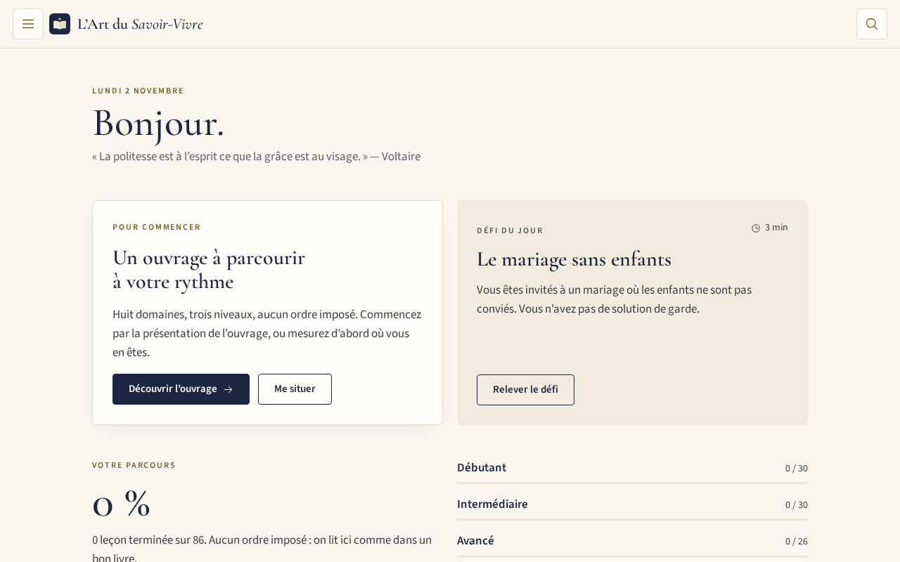
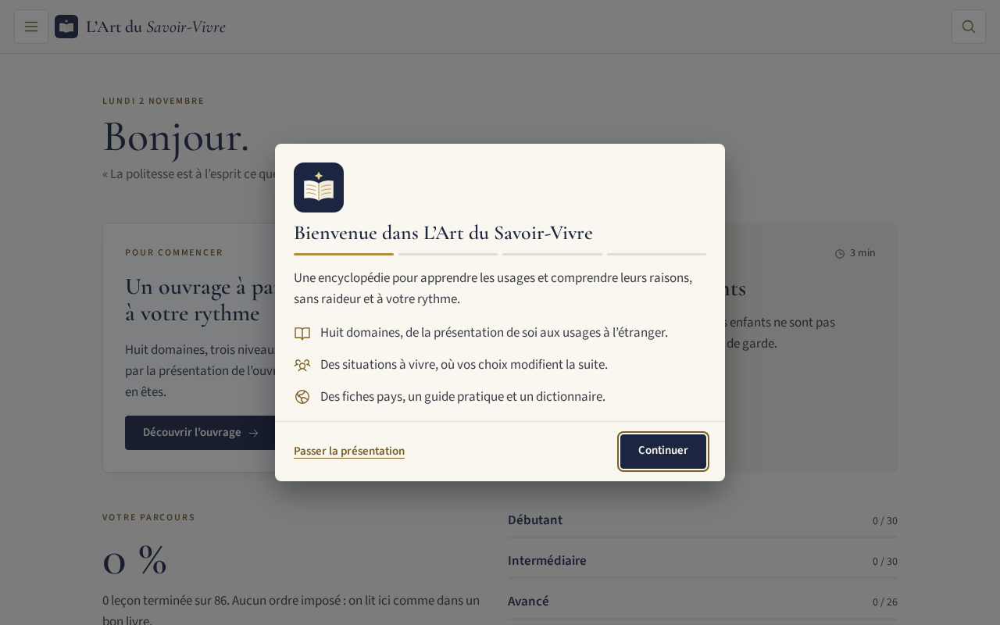
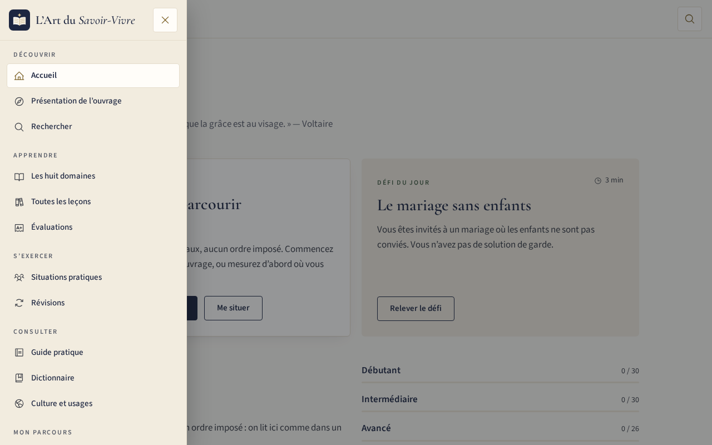
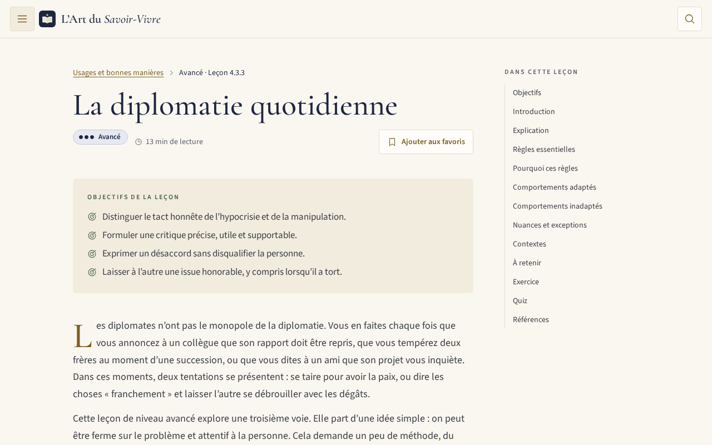
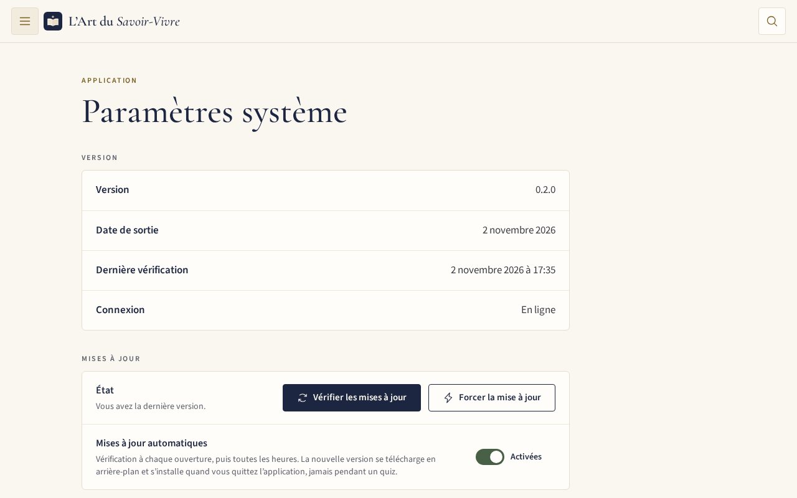
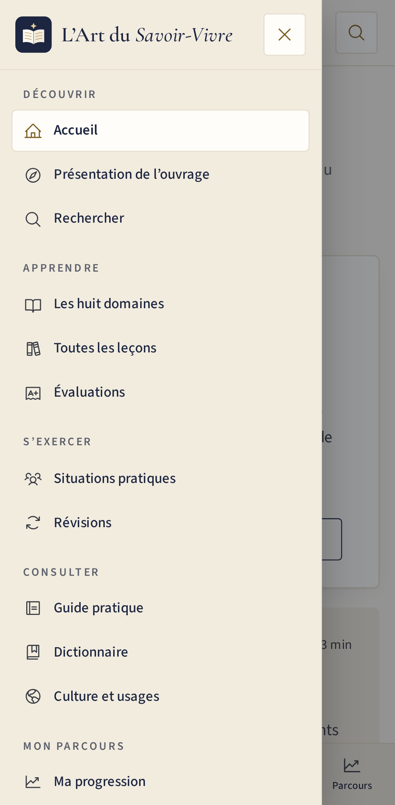

<div align="center">


# L’Art du Savoir-Vivre

**Une encyclopédie interactive des bonnes manières, de l’élégance et des relations sociales, pour adultes.**




</div>

> [!NOTE]
> Le catalogue est entièrement rédigé, mais les leçons n’ont pas encore été relues par une personne (statut `draft`), et leurs références restent à vérifier. L’application n’est pas encore prête à être présentée comme une source validée. Voir [ce qui reste à faire](app/docs/RESTE-A-DEVELOPPER.md).

## ✨ Fonctionnalités

| | |
|---|---|
| 📚 **Huit domaines, trois niveaux** | De la présentation de soi aux usages à l’étranger, les 158 leçons du catalogue, soit plus de 500 000 mots |
| 🎭 **Situations ramifiées** | 32 scénarios où vos choix modifient la suite |
| 📝 **Quiz et évaluations** | 790 questions expliquées, évaluations initiale et finale par niveau |
| 🔁 **Révisions** | Répétition espacée et questions à reprendre |
| 🌍 **Références** | 40 fiches pratiques, 64 définitions, 12 fiches pays |
| 🔍 **Recherche locale** | Dans tous les contenus, sans tenir compte des accents |
| 📴 **Hors ligne** | Tout fonctionne sans connexion après la première visite |
| 🔄 **Mises à jour automatiques** | Téléchargées en arrière-plan, installées quand vous quittez l’application, jamais pendant un quiz |
| 📲 **Installation guidée** | Un bouton pour l’ajouter à l’écran d’un mobile ou d’un ordinateur |
| 🔒 **Vie privée** | Ni compte, ni traceur : la progression reste sur l’appareil |

## 📸 Captures d’écran

<table>
  <tr>
    <td width="50%"><br><sub>🚀 Premier lancement</sub></td>
    <td width="50%"><br><sub>🍔 Menu par catégories</sub></td>
  </tr>
  <tr>
    <td><br><sub>📖 Une leçon</sub></td>
    <td><br><sub>⚙️ Paramètres système</sub></td>
  </tr>
  <tr>
    <td align="center"><br><sub>📱 Accueil sur mobile</sub></td>
    <td align="center"><br><sub>📱 Menu sur mobile</sub></td>
  </tr>
</table>

## 🚀 Démarrage

Prérequis : Node.js 22.12 ou plus récent.

```bash
cd app
npm install
npm run dev
```

Pour essayer la version de production, avec le mode hors ligne et les mises à jour :

```bash
npm run build && npm run preview
```

## ☁️ Déploiement sur Cloudflare

Tout est prêt dans `app/` : `wrangler.jsonc`, `.node-version` et `public/_headers` (cache et en-têtes de sécurité).

**Depuis votre poste :**

```bash
cd app
npx wrangler login
npm run deploy
```

**Ou à chaque `git push`**, dans le tableau de bord Cloudflare (*Workers & Pages* → *Create* → *Import a repository*) :

| Réglage | Valeur |
|---|---|
| Root directory | `app` |
| Build command | `npm run build` |
| Deploy command | `npx wrangler deploy` |

Le détail est dans la [documentation de maintenance](app/docs/MAINTENANCE.md#déployer-sur-cloudflare).

## 🧪 Tests

```bash
cd app
npm run lint
npm test
npm run build && npm run test:e2e
```

## 📖 Documentation

- 🛠️ [Installation et commandes](app/README.md)
- 🏗️ [Documentation technique](app/docs/TECHNIQUE.md)
- 🔧 [Maintenance et déploiement](app/docs/MAINTENANCE.md)
- ✍️ [Guide éditorial](app/docs/GUIDE-EDITORIAL.md)
- ✅ [Fonctionnalités réellement implémentées](app/docs/RAPPORT-FONCTIONNALITES.md)
- 🧾 [Tests exécutés](app/docs/RAPPORT-TESTS.md)
- 🗺️ [Reste à développer](app/docs/RESTE-A-DEVELOPPER.md)

## ⚖️ Avertissement

Cette application est fournie à titre informatif. L’éditeur n’est pas responsable des données qu’elle fournit ni de l’usage qui en est fait. Les usages décrits sont des repères, et les mentions de droit ne remplacent pas un professionnel. Texte complet dans l’application, rubrique *Mentions légales*.

Le plan général s’inspire des thèmes de *Le bonheur de séduire* (N. de Rothschild, 1991) ; aucun texte de cet ouvrage n’est repris.
